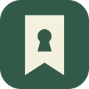
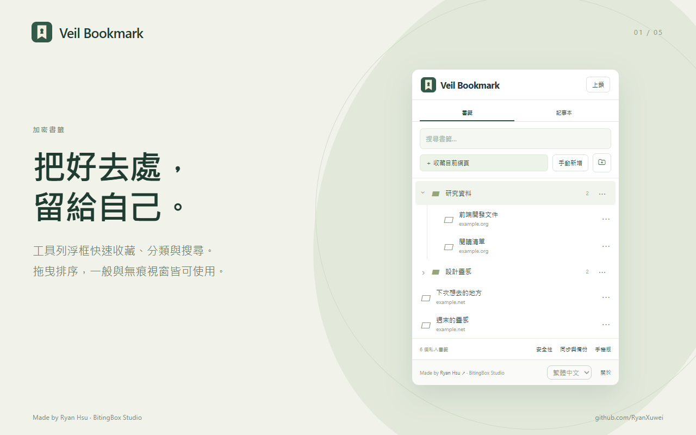
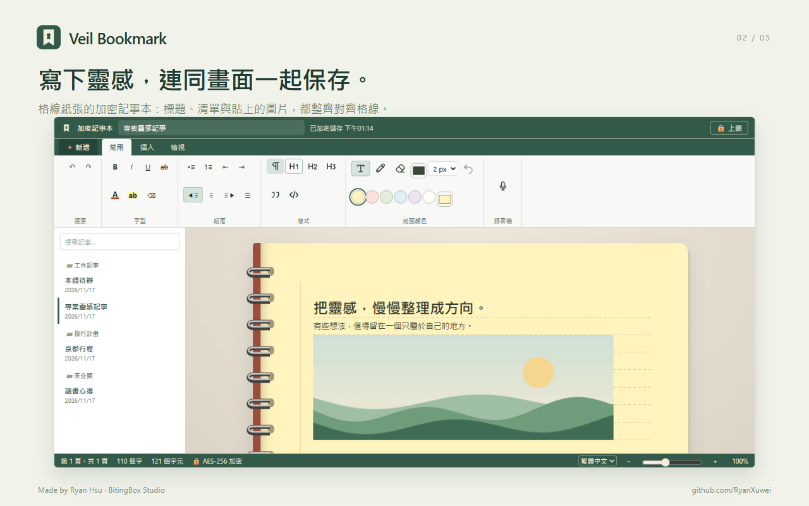

<div align="center">



# Veil Bookmark

### 只有你打得開的私人書籤與記事本

不想被看到的收藏，不該躺在瀏覽器的書籤列上。<br>
Veil Bookmark 用你的主密碼把書籤和記事全部加密。不必註冊帳號，沒有伺服器，沒有追蹤，完全免費。

<a href="https://chromewebstore.google.com/detail/chpabfajilpjflfmnkopjjcnoaaliefg"></a>
&nbsp;
<a href="https://veil-bookmark.bitingbox.win/"></a>

**[👉 到 Chrome 線上應用程式商店安裝](https://chromewebstore.google.com/detail/chpabfajilpjflfmnkopjjcnoaaliefg)**



</div>

<div align="center">

## 🎬 武俠篇宣傳影片

### 妖不必斬，收起來就好｜免費加密書籤 Veil Bookmark 武俠篇

<a href="https://www.youtube.com/watch?v=ECOXEfD-b68"></a>

**[▶ 前往 YouTube 觀看武俠篇](https://www.youtube.com/watch?v=ECOXEfD-b68)**

Made by [Ryan Hsu](https://github.com/RyanXuwei) · [BitingBox Studio](https://github.com/RyanXuwei)

</div>

## 為什麼用 Veil Bookmark

| | |
|---|---|
| 🔒 **真的只有你看得到** | 書籤、標籤、備註、記事全部在你的瀏覽器裡用 AES-256 加密。開發者沒有伺服器，看不到也收不到你的資料。 |
| 🕶️ **不留在書籤列** | 收藏不會出現在 Chrome 書籤列或書籤管理員。一般視窗與無痕視窗都能用。 |
| 📝 **不只是書籤** | 內建 Word 風格的加密記事本：格線紙張、貼圖、手繪、錄音，還能另存 PDF。 |
| 📱 **手機也能開** | 掃 QR code 就能在手機上看書籤、寫記事，支援 Face ID／指紋解鎖。 |
| ☁️ **同步由你決定** | 想跨裝置就開 Google Drive 同步，上傳的只有密文，放在你自己的 Drive 裡。不開也完全能用。 |
| 🗝️ **忘記密碼有救** | 救援金鑰可以重設主密碼；閒置 15 分鐘自動上鎖。 |
| 🌏 **五種語言** | 繁體中文、简体中文、English、日本語、한국어。 |

<div align="center">



## 手機掃一下，帶著走

<a href="https://veil-bookmark.bitingbox.win/"></a>

用手機相機掃描，或直接開啟 <https://veil-bookmark.bitingbox.win/><br>
不用先裝擴充功能：連上 Google 帳號就能直接建立保險庫。已在電腦用擴充功能的人，連同一個 Google 帳號、輸入主密碼就能用。

</div>

Made by [Ryan Hsu](https://github.com/RyanXuwei) · BitingBox Studio　｜　[隱私權政策](https://ryanxuwei.github.io/veil-bookmark/privacy.html)　｜　目前版本：1.23.0

## 功能

- **私人書籤**：資料夾、標籤、私密備註與搜尋；一鍵收藏目前網頁。不會加入 Chrome 書籤列。
  - 標籤以小圓角標記顯示，輸入時會依使用次數列出已用過的標籤供快選；按逗號或 Enter 完成一個標籤。
  - 滑鼠停在浮框的書籤上，會顯示它的標籤與私密備註，方便速查。
- **側邊欄模式**：按浮框右上角的側邊欄按鈕，Veil Bookmark 就會開在 Chrome 側邊欄，邊瀏覽網頁邊收藏、查詢；也可在「同步與備份」設定點工具列圖示時直接開啟側邊欄。無痕視窗一律使用浮框。第一次在側邊欄按「收藏目前網頁」時，Chrome 會詢問一次是否允許讀取分頁，之後就能直接收藏正在看的網頁。
- **暗黑模式**：在「同步與備份 › 外觀」（手機版「同步與設定 › 外觀」）選擇跟隨系統、淺色或深色；預設跟隨系統。記事紙張保留你選的紙色。
- **多層資料夾與拖曳排序**：書籤與記事都能建立多層資料夾（資料夾的「⋯ › 新增子資料夾」），項目和資料夾都能拖曳排序、拖進或拖出資料夾；把資料夾拖到另一個資料夾的中間就會放進去（鍵盤可用 Alt + ↑／↓）。資料夾與記事都有「⋯」選單，可重新命名、移動或刪除；刪除資料夾時，裡面的項目與子資料夾會移到上一層，不會被刪除。
- **加密記事本**：類似 Word 的網頁記事本，有功能區（內文／標題／引文／程式碼樣式、粗體、色彩、清單、對齊、連結）、A4 頁面、字數與縮放；自動加密儲存，可列印或另存 PDF（「檢視 › 列印／另存 PDF」，存 PDF 時在列印視窗的目的地選「另存為 PDF」）。儲存失敗會保留草稿，切換文件前會先等候儲存完成。從浮框的「記事本」分頁開啟。
- **右鍵加入記事本**：在任何網頁選取文字按右鍵「加入 Veil 記事本」，或在圖片上按右鍵「圖片加入 Veil 記事本」，就會存成一則記事，附上網頁標題與回到原網頁的連結。上鎖時會先開啟 Veil 請你解鎖，內容在解鎖前只暫放在 Chrome 記憶體。
- **Markdown 與 Mermaid 預覽**：用 Markdown 語法寫記事，在「檢視 › Markdown 預覽」（手機版閱讀畫面的「MD」）切換成排版好的樣子；```mermaid 區塊會畫成流程圖、時序圖等圖表。
- **匯入文件**：在記事本頁按「匯入」，選擇文字檔（.txt，UTF-8／UTF-16，或舊式的 Big5、GBK、Shift_JIS、EUC-JP、EUC-KR 編碼，會自動判斷）、Markdown（.md）、網頁（.html）或 Word（.docx），每個檔案會成為一則新記事；Word 的標題、粗體、清單、連結與圖片都會保留，表格會轉成一行一列的文字。舊版 .doc 請先在 Word 另存為 .docx。匯入完全在你的電腦上進行，不會上傳檔案。
- **一致的刪除確認**：書籤、記事與資料夾的刪除都會先跳出同一個確認視窗，說明刪除會同步到所有裝置。
- **一般與無痕都能用**：點書籤會在目前的瀏覽模式開啟，也可以另開無痕視窗。在無痕視窗收藏的書籤會標上「無痕」，之後在一般視窗點它也會自動用無痕視窗開啟（編輯書籤可取消）。
- **無痕專用資料夾**：「🕶 無痕專用」只在無痕視窗顯示，一般視窗看不到；手機版一律顯示為灰色按鈕，點開確認後才列出內容，也能在裡面新增書籤（手機網頁無法用無痕模式開啟書籤），上鎖後再次隱藏；在無痕視窗新增的書籤預設放在這裡，開啟時一律用無痕視窗。這是顯示上的區隔，資料仍受同一組主密碼加密保護。
- **圖片配置模式**：點選圖片可切換「圖文模式」（跟隨原段落）與「自由模式」（在內容區任意拖放、不佔段落空間）。自由圖片可縮放，也能切換鉛筆在圖片上畫記；位置、大小與模式皆加密保存，手機版同步支援。
- **調整圖片大小**：在記事編輯畫面點選圖片，拖曳藍色控制點即可等比例縮放；支援桌面滑鼠與手機觸控，尺寸會隨記事加密保存。按 Esc 或點其他位置可取消選取。
- **貼上圖片**：直接貼上截圖或複製的圖片、拖曳圖片檔，或用「插入 › 圖片」。圖片會自動縮小並與記事一起加密，不會保留拍攝地點等資料。
- **仿真便簽**：鵝黃色紙張、虛線行線與金屬活頁環；文字、標題與圖片都對齊格線，點任何一行就能從那一行開始打字；可選預設色或自訂整頁紙張顏色，每篇記事分別保存。
- **隨手塗**：切換鉛筆後可在紙張任意位置手寫或繪圖，支援滑鼠、觸控與觸控筆；可選筆色與粗細、擦除整條筆畫或復原最後一筆。切回「文字」繼續編輯。
- **錄音貼紙**：開始、暫停、繼續及停止錄音。錄完點紙張任意位置放置播放貼紙，拖曳貼紙頂端移動，點播放鍵收聽。錄音與位置隨記事加密儲存；每段最多 3 分鐘，每篇最多 5 段並受容量限制。
- **自動上鎖**：閒置 15 分鐘、電腦鎖定或關閉所有 Chrome 視窗後自動上鎖。
- **修改主密碼**：在「安全性」先驗證原密碼，再輸入新密碼與確認；至少 4 個字元，書籤、記事與原救援金鑰都會保留。
- **救援金鑰**：忘記主密碼時，可用建立保險庫時取得的救援金鑰重設密碼。
- **加密備份**：可匯出加密備份檔，在新電腦還原。
- **選用 Google Drive 同步**：只上傳加密後的資料到 Drive 的隱藏應用程式資料夾。
- **五種語言**：繁體中文、简体中文、English、日本語、한국어。

## 安裝

從 Chrome 線上應用程式商店安裝：<https://chromewebstore.google.com/detail/chpabfajilpjflfmnkopjjcnoaaliefg>

1. 開啟上面的連結，按「加到 Chrome」。
2. 點工具列上的 Veil Bookmark 圖示，設定至少 4 個字元的主密碼，並把畫面上顯示的**救援金鑰**抄寫、列印或下載後離線保存。
3. 若要在無痕視窗使用：在擴充功能的「詳細資料」開啟「允許在無痕模式中執行」。

商店上的版本需要經過審查，可能比這裡的最新版稍晚。想先用最新版，或不經由商店安裝時，可以手動安裝：

1. 下載並解壓縮 `VeilBookmark_v<版號>_Chrome.zip`，放在固定的資料夾。
2. 在 Chrome 網址列輸入 `chrome://extensions`，開啟右上角的「開發人員模式」。
3. 按「載入未封裝項目」，選擇剛才解壓縮的資料夾。

商店版與手動安裝版是兩個不同的擴充功能（ID 不同），本機資料不共用；要在兩者之間搬移資料，請用 Google Drive 同步或加密備份檔。

### 錄音使用

首次錄音需允許 Chrome 使用麥克風；一般及無痕視窗的權限可能需分別允許。錄音完成並放置後才會保存，上鎖或離開會停止麥克風並捨棄未完成／未放置的錄音。錄音保存在加密保險庫內；啟用 Drive 同步時也隨加密資料同步。大量錄音會增加備份大小與同步時間。

### 更新版本

1. 先在「同步與備份」按「匯出加密備份」。
2. 用新版檔案覆蓋原本的資料夾，到 `chrome://extensions` 按「重新載入」。請勿先解除安裝，否則本機資料會被刪除。

> 0.2.0 的資料與備份無法在 0.1.9 以前的版本開啟。多台電腦同步時請全部更新。
>
> 從 0.1.7 以前的版本升級時，擴充功能會被 Chrome 視為新的項目，原本的資料不會自動帶過來。請先匯出加密備份，安裝新版後在歡迎畫面選「已有備份？從加密檔案還原」。

## 忘記主密碼

- 在解鎖畫面按「忘記主密碼？使用救援金鑰」，輸入救援金鑰並設定新的主密碼。
- 換了新電腦：在歡迎畫面選「已有備份？從加密檔案還原」，再按「忘記密碼？用救援金鑰從備份還原」。
- 重設完成後會產生一組新的救援金鑰，舊的金鑰立即失效。
- 已使用 Drive 同步的其他電腦，同步後也會改用新的主密碼。
- 從舊版升級的保險庫還沒有救援金鑰，請到「安全性 → 救援金鑰」建立。

## 手機版（網頁）

手機，或 Safari、Firefox 等不能安裝擴充功能的瀏覽器，都可以開啟手機版：<https://veil-bookmark.bitingbox.win/>。在擴充功能按「手機版」會顯示 QR code，用手機相機掃描即可開啟。

1. 開啟上面的網址，按「使用 Google 帳號連接 Drive」。
2. 第一次使用（Google Drive 上還沒有保險庫）：輸入兩次主密碼、按「建立保險庫」，保存畫面上的救援金鑰後按「我已保存，開始使用」就建立好了，不需要擴充功能。之後在電腦安裝擴充功能，用「從 Google Drive 還原」和同一組主密碼就能接上。已經在電腦用擴充功能的人，選擇同一個 Google 帳號即可。
3. 輸入主密碼即可瀏覽、搜尋、新增、編輯與刪除書籤；修改會同步回電腦。
4. 「記事本」分頁可以閱讀、新增、編輯與刪除記事，也能用「匯入檔案」把 .txt、.md、.html、.docx 變成記事：粗體、斜體、底線、刪除線、標題、項目符號與編號清單、引言、螢光筆、插入照片、紙張顏色與資料夾。也能手寫（手指或觸控筆）與錄音，格式與電腦版相同，兩邊都看得到；字型與版面配置請在電腦上使用。

- 可以「加到主畫面」當成 App 使用。
- **分享進 Veil Bookmark（Android）**：加到主畫面後，在 Chrome 選取文字按「分享」、或在相簿／其他 App 分享圖片，選 Veil Bookmark 就會存成一則記事（附上來源網址）；只分享網址則直接建立書籤，不必再按「加入書籤」：名稱沒有時先用網站名稱，資料夾、標籤、備註之後再補填；已收藏過的網址不會重複建立。保險庫上鎖時也能連續分享多個網頁，每個網址都會先用這支手機的分享金鑰加密暫存（不需要解鎖），下次解鎖時一次加入書籤。分享的文字與圖片在上鎖時只暫放在記憶體，解鎖後才加密存入。
- **iPhone**：Safari 不支援網頁出現在分享選單。可以複製文字或圖片，到「記事本」新增記事後貼上；或用「捷徑」App 做一個分享捷徑（接收文字與網址 → 「URL 編碼」→ 打開 `https://veil-bookmark.bitingbox.win/?text=` 加上編碼後的文字）。注意：捷徑會把文字放在網址裡，Safari 的瀏覽紀錄會留下這段文字，私密內容請用複製貼上。
- 主密碼只在手機上使用；手機保留一份加密副本，沒有網路時也能開啟。閒置 15 分鐘或離開 5 分鐘後自動上鎖。
- 可在「同步與設定」啟用 **Face ID／指紋解鎖**（需要支援通行金鑰的手機與瀏覽器，例如 Android 的 Chrome、iOS 18 以上的 Safari）。主密碼不會被儲存；每 30 天需要輸入一次主密碼。
- Google 連線約 1 小時後過期，之後的修改會先存在手機，重新連線後再上傳。
- 用電腦版 Google Chrome 開啟手機版網址時，會直接轉到 Chrome 線上應用程式商店的擴充功能頁面；其他電腦瀏覽器（Firefox、Safari、Edge 等）仍可使用手機版。

## Google Drive 同步（選用）

已內建 Google 授權，不需要建立 Google Cloud 專案或輸入任何金鑰：

1. 解鎖後，在「同步與備份」按「連接 Google Drive」。
2. 在 Google 授權視窗選擇要用來同步的帳號，按「允許」。若 Chrome 尚未登入 Google，會先請你登入。
3. 完成。解鎖時會立即同步，新增或修改後約 1 秒內上傳，解鎖期間每 5 分鐘再檢查一次。

換新電腦時，安裝後打開 Veil Bookmark：如果這個 Google 帳號先前已授權，歡迎畫面會自動顯示「在 Google Drive 找到你的保險庫」，輸入原本的主密碼即可還原。若沒有自動出現，按「檢查 Google Drive」或「從 Google Drive 還原」。

如果連接時 Drive 上已經有另一個保險庫（例如重新安裝後不小心建立了新的保險庫），「同步與備份」會請你選擇要保留哪一份：

- **改用 Drive 上的保險庫**：輸入 Drive 那份的主密碼。這台電腦原本的資料會先自動下載為加密備份。
- **以這台電腦取代 Drive**：輸入這台電腦的主密碼並勾選確認。Drive 上的舊資料會被刪除，無法復原。

Google 帳號的儲存空間已滿時，同步會暫停並在主畫面提示；資料仍安全保存在這台電腦，清出空間後會自動繼續同步。Drive 的隱藏應用程式資料夾同樣占用 Google 帳號的儲存空間，但通常只有一份最新的加密快照。

同一台電腦有多人使用時，每個 Chrome 設定檔各有自己的保險庫，並同步到該設定檔登入的 Google 帳號，彼此不會衝突。

- 只請求 `drive.appdata` 權限，資料放在 Drive 的隱藏應用程式資料夾，不會讀取你的其他檔案。
- 上傳前已用主密碼加密，Google 看不到書籤與記事內容。
- 可隨時在 [Google 帳戶的第三方存取權](https://myaccount.google.com/permissions)移除授權。
- 同一筆資料在兩台電腦同時修改時，以最後修改的版本為準，請確認電腦時間正確。
- 需要使用 Google Chrome（Chrome 的帳號授權功能）；其他 Chromium 瀏覽器可能無法連接。

## 安全與隱私

- 書籤與記事以隨機產生的資料金鑰（AES-256-GCM）加密；資料金鑰再分別由主密碼（PBKDF2-SHA256，600,000 次）與救援金鑰（160 位元隨機值，HKDF-SHA256）各加密保存一份。
- 主密碼與救援金鑰都不會被儲存；解鎖金鑰只存在瀏覽器工作階段記憶體，上鎖或關閉瀏覽器即清除。
- 沒有開發者伺服器，不含分析、追蹤或廣告，不載入外部網站圖示。
- 一般視窗開啟的網站仍可能留下瀏覽紀錄；無痕模式不會隱藏你的網路活動。
- 解鎖期間，若電腦已遭他人控制，畫面與記憶體內容仍可能被讀取。

完整說明請見[隱私權政策](https://ryanxuwei.github.io/veil-bookmark/privacy.html)。

## 重要聲明（免責聲明）

1. 主密碼與救援金鑰只由你保管。Veil Bookmark 不會在任何地方（本機、Google Drive 或開發者）儲存或傳送你的主密碼或救援金鑰。
2. 忘記主密碼時，唯一的救援方式是使用救援金鑰；開發者無法協助找回密碼、救援金鑰或解密資料。
3. 主密碼與救援金鑰都遺失時，所有加密的書籤與記事將永久無法開啟。
4. 救援金鑰與主密碼同樣重要：取得救援金鑰的人可以重設密碼並開啟你的資料。請離線妥善保管，並定期匯出加密備份。
5. 本軟體依「現狀」提供，不提供任何明示或默示擔保。在法律允許的範圍內，開發者對資料遺失、無法存取或其他損害不負任何責任。

## 使用須知

- 記事本頁面從無痕視窗開啟時，會顯示在一般視窗（Chrome 對擴充功能頁面的規定）；內容一樣加密保存。
- 為了不向外連線，貼上網頁內容時不會載入網路上的圖片；要保留圖片請用「複製圖片」後貼上。
- 記事本目前不支援表格。
- 原始碼公開，歡迎檢視；目前沒有委託第三方做安全稽核。

## 開發

需要 Node.js 22 以上。

```bash
npm ci
npm test
npm run build
```

建置結果在 `dist/`，可直接以「載入未封裝項目」載入。

- 瀏覽器測試：`npx playwright install chromium`，再執行 `scripts/` 內的 `popup-e2e.mjs`、`notebook-e2e.mjs`、`setup-e2e.mjs`、`about-e2e.mjs`。
- 翻譯：編輯 `i18n/translations.tsv`（繁中｜English｜日本語｜한국어），執行 `npm install --no-save opencc-js && npm run i18n` 重新產生；`npm run build` 會先檢查是否有缺漏的翻譯。
- 圖示：`public/icons/icon.svg`，可用 `python scripts/generate_icons.py`（需 Pillow）產生各尺寸。
- 版本紀錄見 [CHANGELOG.md](CHANGELOG.md)，測試紀錄見 [TEST_REPORT.md](TEST_REPORT.md)。

## 授權

© 2026 Ryan Hsu. All rights reserved.

本專案原始碼公開供檢視，但未授權他人使用、修改或散布。第三方套件保留各自授權，見 [THIRD_PARTY_NOTICES.txt](THIRD_PARTY_NOTICES.txt)。

### 手機版多帳戶

在頁面上方按「新增帳戶」連接另一個 Google Drive，再從「切換帳戶」選單切換。每個帳戶的加密副本與 Face ID／指紋設定分開保存，切換時會上鎖，需用該帳戶的主密碼或生物辨識解鎖。兩個分頁可各自選擇不同帳戶；每個帳戶仍需先由電腦插件建立並同步保險庫。

離線修改會保留在原帳戶，不會跟著切換到別的 Drive。「移除此帳戶」僅移除選定帳戶的本機資料與解鎖設定，但尚未同步的修改會遺失，請先確認同步完成。舊版未能確認帳戶歸屬的資料會保留為「升級前的本機副本（離線）」，不會自動上傳。

如果 Veil Bookmark 對你有幫助，歡迎 [Give me a Boba!](https://bitingbox.bobaboba.me)。

### 網頁本機 AI 摘要（電腦版 Chrome）

在一般網頁按右鍵，選「用本機 AI 摘要並存入 Veil」。Veil 會開啟摘要頁；若已上鎖，先解鎖。確認來源與摘要語言後，按「開始本機摘要」，看過內容後按「加密存入記事本」。記事會附來源標題、網址與時間，按原設定加密備份及同步。

預設繁中輸出。Chrome 摘要 API 未直接支援中文時，使用本機翻譯成英文後摘要，再翻回繁中；翻譯與摘要可能有誤，請對照原文。首次使用可能下載 Chrome 模型，需支援本機 AI 的電腦、Chrome 及足夠磁碟空間；不支援時會顯示說明，不會把頁面改送雲端。模型推論不需 API 金鑰。硬體與語言限制以 [Chrome 官方文件](https://developer.chrome.com/docs/ai/summarizer-api) 為準。

只讀取目前頁面的可見文字，略過表單與隱藏元素，不包含其他分頁、跨來源框架、影片或圖片中的文字。每次最多 24,000 字元，超長會顯示前段摘要提示；請於十分鐘內完成。Chrome 內建頁、商店頁或受保護頁面可能無法擷取。手機版不提供產生功能，但能閱讀已存入的摘要記事。

### 右鍵快速收藏與自動命名

在一般網頁空白處或連結上按右鍵，選「快速加入 Veil 書籤」。會直接收藏目前頁面或連結目標；優先使用可取得的分頁／網頁標題，取不到時以網域名稱保存。重複快速收藏不會覆蓋既有名稱、標籤與備註。無痕收藏會放入無痕專用資料夾。

上鎖時先暫存在瀏覽器 session 記憶體（最多20筆、30分鐘），解鎖後才加密保存並依設定同步。逾時或關閉 Chrome，尚未保存的暫存會清除。

手動新增書籤時，名稱可留空。儲存時先嘗試取得網頁名稱，失敗就使用網域；之後可自行改名。取得標題不帶登入 cookies，也不會繞過網站限制。跨來源存取、登入頁、需要 JavaScript 才顯示標題的網站或手機版網站安全政策，都可能讓標題無法取得而改用網域。此調整不影響既有書籤的自訂名稱。
